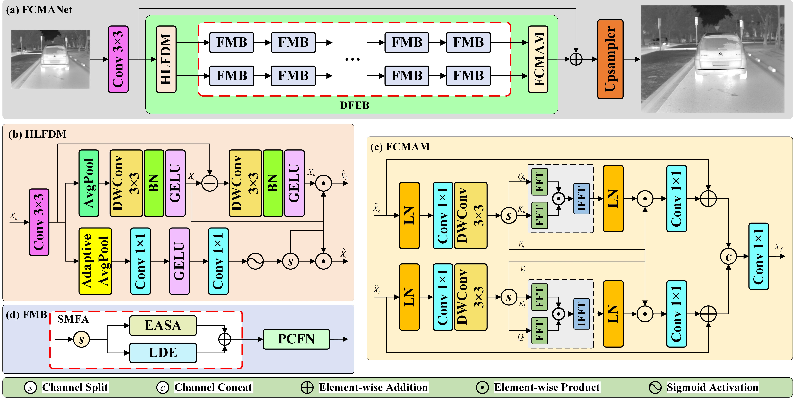

### 📖 FCMANet: Feature‑Decoupling Cross-Modulation Aggregation Network for efficient Infrared Image Super-Resolution

---
<p align="center">
  
</p>

*An overview of the proposed FCMANet. FCMANet first transforms the input LR image into the feature space using a convolutional layer, performs feature extraction using a series of deep feature extraction block (DFEBs), and then reconstructs these extracted features by an upsampler module. The DFEB block is mainly implemented by a high-low frequency feature decoupling module (HLFDM), a series of feature modulation blocks (FMBs) and a frequency cross-modulation fusion module (FCMAM).*

## 🔧 Requirements and Installation
> - Python 3.8, PyTorch >= 1.11
> - BasicSR 1.4.2
> - GPU: NVIDIA RTX 3090
> - Platforms: Ubuntu 20.04, cuda-11.3 or higher

### Installation
```
# Clone the repo
git clone https://github.com/smilenorth1/FCMANet-main.git
# Install dependent packages
cd FCMANet-main
pip install -r requirements.txt
# Install BasicSR
python setup.py develop
```
You can also refer to this [INSTALL.md](https://github.com/XPixelGroup/BasicSR/blob/master/docs/INSTALL.md) for installation

## Dataset Information
### Training Dataset
- **CVC‑09‑1K**: Derived from CVC‑09 FIR Sequence Pedestrian Dataset, containing 1000 infrared images with resolution 640×480 for network training. 
  - Reference: Kyaw, H., & Hogg, D. (2016). Adapting pedestrian detectors to new domains: A comprehensive review. *Engineering Applications of Artificial Intelligence*.
  - The training daraset can be obtained from https://opendatalab.org.cn/OpenDataLab/CVC-09/tree/main.

### Testing Datasets
We evaluate model performance on five public infrared benchmark datasets: resultsA, resultsC, M3FD, IR700, FLIR ADAS (2022).
1. resultsA & resultsC: Public infrared test sets, see Liu et al.(2018), Bai et al.(2024).
2. M3FD: Multi‑modal infrared‑visible detection benchmark, Liu et al.(2022).
3. IR700: Infrared super‑resolution test dataset, Zou et al.(2021).
4. FLIR ADAS (2022): Public automotive thermal infrared dataset.

### Data Preprocessing
1. Generate low-resolution (LR) training samples by bicubic down-sampling from original high-resolution (HR) infrared images.
2. Randomly crop 64×64 image patches from LR-HR image pairs during training.
3. Data augmentation: random horizontal flip, random rotation.

## Code Information
This repository contains the official PyTorch implementation of FCMANet.
- Framework: Built on BasicSR 1.4.2 open‑source image restoration toolbox.
- Core modules implementation: HLFDM, FMB, FCMAM, FFT‑based frequency loss function.
- Included files: training configuration files, test configuration files, network definition scripts, dataset preprocessing & reproduction scripts.
- Pretrained weights for ×2 and ×4 infrared super‑resolution are provided.

## Usage Instructions

### 1. Prepare Datasets
1. Download training dataset CVC-09-1K and put it under `./datasets/train/`
2. Download test datasets and place them under `./datasets/test/`
3. Modify dataset path parameters in corresponding `.yml` config files under `options/train/` and `options/test/`.

### 2. Model Weights
The pretrained model weights results are stored under `./experiments/pretrained_models/`.

### 3. Training
Run the following commands for training:
```
# Train FCMANet for x2 infrared image super-resolution
python basicsr/train.py -opt options/train/train_FCMANet_x2.yml
# Train FCMANet for x4 infrared image super-resolution
python basicsr/train.py -opt options/train/train_FCMANet_x4.yml
```
### 4. Testing
Run the following commands for testing:
```
# Test FCMANet for x2 infrared image super-resolution
python basicsr/test.py -opt options/test/test_FCMANet_x2.yml
# Test FCMANet for x4 infrared image super-resolution
python basicsr/test.py -opt options/test/test_FCMANet_x4.yml
```
- Output reconstruction results will be saved in `./results/` directory.

### 5. Dataset Reproduction Script
The script for simulating bicubic down‑sampling LR images and dataset preprocessing is located in `./scripts/generate_lr_dataset.py`.
Run this script to reproduce synthetic training pairs:
```
python scripts/generate_lr_dataset.py
```

## Methodology
1. **Shallow feature extraction**: Input LR infrared image passes through 3×3 convolution to get shallow feature maps.
2. **Frequency decoupling**: HLFDM module splits feature maps into low‑frequency branch for global structural information modeling and high‑frequency branch for local texture details extraction.
3. **Feature modulation**: Stacked FMB blocks learn discriminative deep features for two frequency branches.
4. **Cross‑modulation aggregation**: FCMAM uses FFT‑based cross‑modulation to implement adaptive feature exchange and fusion between low‑frequency and high‑frequency streams.
5. **Reconstruction**: Upsample module generates final high‑resolution infrared output.
6. **Loss function**: Hybrid loss combining L1 spatial loss and FFT frequency‑domain loss (λ=0.05).
7. **Evaluation metrics**: PSNR (Peak Signal‑to‑Noise Ratio) and SSIM (Structural Similarity Index Measure) for quantitative evaluation. FLOPs and Parameters are computed by fvcore library for complexity assessment

## Citation
If you find this work useful for your research, please cite our paper:
```
@article{liufcmanet2026,
  title={FCMANet: Feature‑Decoupling Cross‑Modulation Aggregation Network (FCMANet) for Efficient Infrared Image Super‑Resolution},
  author={Zepeng Liu, Guliaisarehan Maisaidi, Zhizhong Fu},
  journal={PeerJ},
  year={2026}
}
 ```
Please also cite related datasets and BasicSR toolbox as mentioned in the manuscript.

## License
This project is open‑source under **MIT License**.
> See the `LICENSE` file for full license terms.

## 📧 Contact
If you have any questions, please feel free to reach me out at 202311012318@std.uestc.edu.cn.

## 🤗 Acknowledgement
This code is based on [BasicSR](https://github.com/XPixelGroup/BasicSR) toolbox. Thanks for the awesome work.
